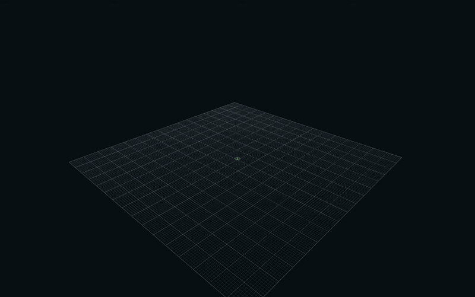
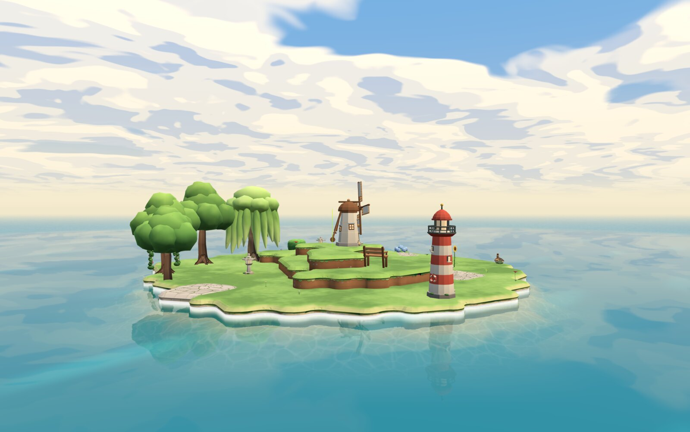
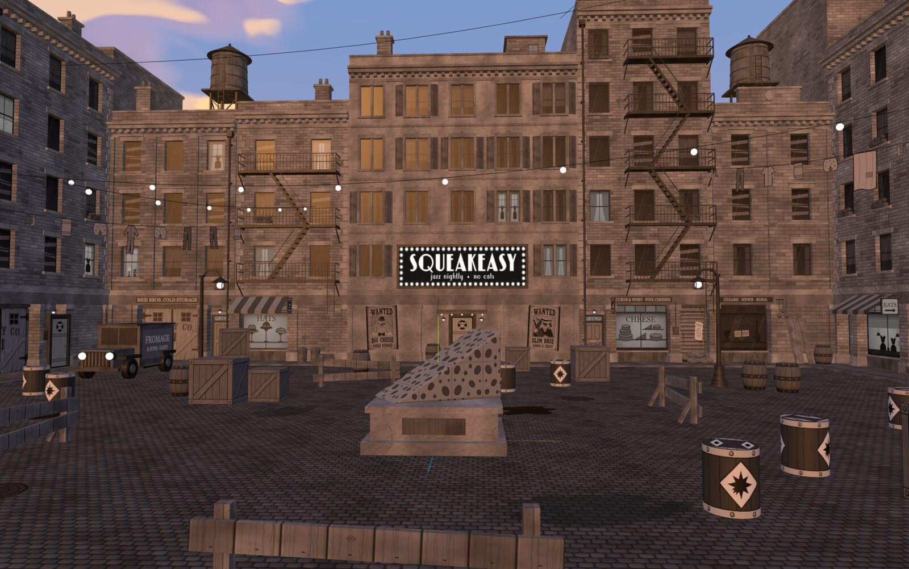
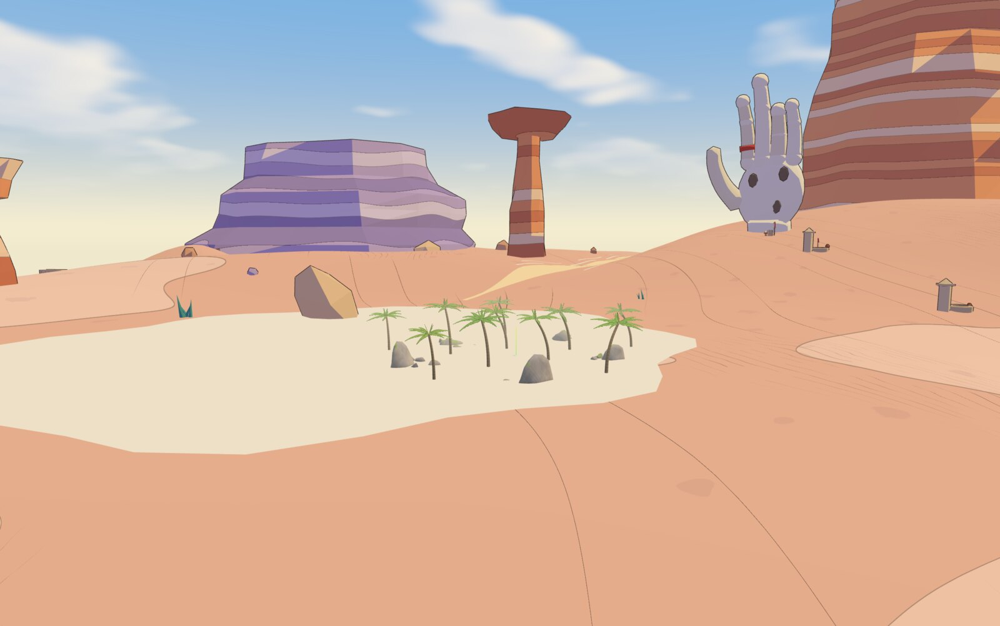
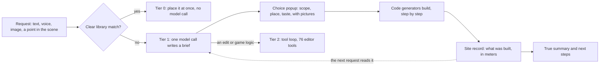
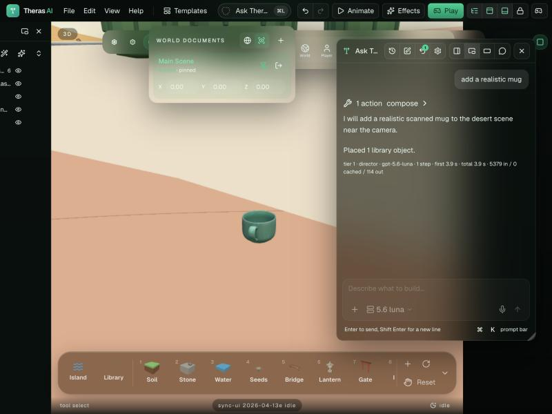
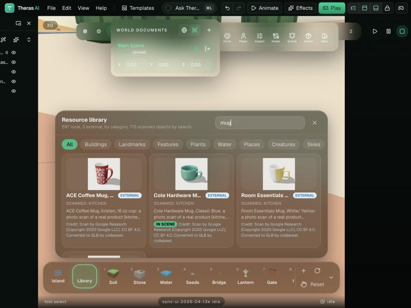
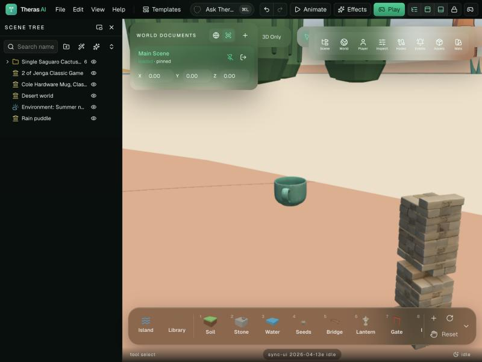

# Theras AI

Theras AI is a 3D world editor that runs in the browser. You say what you want in plain words, with an image, or by pointing at a place in the scene. The editor builds it while you watch, and you can walk through the result with physics.

Theras AI is developed and maintained by Theras Labs, Inc. It is open source under the MIT License. The project combines its editor, runtime and tooling with an AI harness, a resource library, provider integrations and game mode.

## What it builds



From nothing to a city. The prompt was "build a downtown city with parks and tree-lined streets. Do not add a sky or any environment." The model wrote its brief in 4 s. The editor asked how big the city must be. Code then built 5 x 5 blocks, about 500 objects, in 19 s. The picture is a time-lapse of that build.

| | |
|---|---|
|  |  |
| **City.** Three more prompts added the towers: art deco (130 m), glass (90 m) and needle (110 m). Before each tower the editor asked where it must stand. Each tower was built in about 5 s. | **Island.** The template "Cozy island". The rowboat and the campfire came from "add a rowboat near the lighthouse" and "add a campfire near the bench". The editor placed both with no model call. |
|  |  |
| **Alley arena.** A template. Code builds the place again from its data and its drawn textures. | **Desert.** The template "Desert of the giants". Two prompts added the palm trees and the rocks. Before the second one the editor asked which trees. |

All pictures are captures of the 3D view of the editor (`apps/editor`, port 8080), taken on 2026-11-11 with the model `gpt-5.6-luna`. They were only made smaller for this page. The files are in `docs/media`.

## Folders, ports and roles

| Folder | Port | Role |
|---|---|---|
| `apps/orchestrator` | 4300 | Local entry point. Starts the tools and switches between them. |
| `apps/editor` | 8080 | The world editor. The AI harness, the library and game mode are here. |
| `apps/animation-editor` | 8081 | Animation graphs and clips. |
| `server` | 4310 | The AI server. It holds the model keys and scans project folders. |
| `packages/*` | none | Runtime, editor core, geometry and shared types. |
| `docs/plans` | none | The harness plan, the cause tables and the measured results. |

## The harness: the model directs, code builds, you choose

A plain chat model that writes scene code gives random results: boxes in place of buildings, a river across a street, a summary that claims things that are not in the scene. Theras AI does not let the model place geometry for a build. The model has one job: to understand the request and write a short brief. Code that knows spacing, scale and style does the building.



| Step | What happens | Where |
|---|---|---|
| Tier 0 | A request that names one library object ("add a lantern") is placed with no model call. | `apps/editor/src/lib/copilot/instant-path.ts` |
| Brief | One model call fills the tool `submit_brief`: 1 to 4 tasks, each with a generator and a few params. | `apps/editor/src/lib/copilot/director/brief.ts` |
| Choices | One popup asks what the request left open. Options have pictures that are drawn from the real plan. | `apps/editor/src/components/editor-shell/ChoicePopup.tsx` |
| Build | A generator builds in one undo step, with a visible build-up. | `apps/editor/src/lib/copilot/director/generators` |
| Memory | Each generator stores a site record on its folder node. The next request reads it as `[Built]`. | `apps/editor/src/lib/copilot/director/site.ts` |
| Tool loop | Edits, materials, mesh work and game logic use the editor tools. | `apps/editor/src/lib/copilot/tool-declarations.ts` |

### Generators

| Generator | Builds | Asks first |
|---|---|---|
| `city` | A street grid with zones (downtown core, low-rise, park, plaza), buildings, lamps and street trees. Sizes from 2 x 2 to 5 x 5 blocks. | Size (plan maps), character, street trees |
| `river` | A river that follows the street plan of a city, with banks, reeds and a bridge at each crossing. | Route (plan maps) |
| `architecture` | One landmark: a modern tower from 20 to 300 m with an entrance hall, a Japanese castle, a pagoda, a shrine, a keep. | Lot (map), look, height |
| `interior` | The inside of a building: a floor finish, a ceiling with lights and the furniture of its use (lobby, office, cafe lounge, apartment), sized to the hall. With no building, a room that stands alone. | Use, finish (plan pictures) |
| `compose` | Library objects in groups, around an anchor, on free ground. | Which trees, bushes, flowers, buildings |
| `object` | One object that the library does not have, as a parts list that code checks and builds. The same model can be made bigger in place, recolored, or repeated as a group, a row or a closed ring around another thing, with no new model call. | Readings of a word with two meanings |

### The rules of the harness

These rules came from requests that failed. Each one is enforced in code, not only asked for in the prompt.

1. **It sees what it built.** Each build leaves a record with real numbers: the street plan, the heights, the style. The model reads one line for each built thing and one line for the style of the scene.
2. **It asks before a big build.** Scope (how big), place (which route, which lot) and taste (which trees, which look) belong to the user. Code removes a taste param that the model set by itself, unless the user's own words decide it.
3. **It fits the scene.** A tower takes a downtown lot. A river runs along the city edge. Default sizes come from the present skyline. Trees keep off the roads.
4. **It changes things in place.** "Taller", "wider" and "another look" build the same thing again at the same place with the stored params. No stand-in box is added. This is true for a modeled object too: "too small, make a giant wall of it around the puddle" keeps the model and places bigger copies of it in a closed ring, in about 3 seconds.
5. **It can work inside a building.** A request such as "add a floor and a ceiling here" finds the building around the player, the selection or the camera, and fits the interior to its hall.
6. **It tells the truth.** The summary is written by code from what is in the scene. A part that was not built is listed with the reason.
7. **It offers the next step.** Each build ends with chips such as "Add a river" or "Another finish".

The plan, the cause of each failure and the measured times are in `docs/plans/realtime-ai-harness.md` (sections 5B, 5C and 9).

## Ways to say what you want

| Way | How | Notes |
|---|---|---|
| Text | Cmd+L or the prompt in the header. Cmd+K opens the small prompt bar. | The text prompt is the default. |
| Voice | The voice orb layout: click and speak. The reply is spoken. | Needs a microphone and the AI server. |
| Image | Attach an image, a video, a code file or a `.glb` to the prompt. | The brief reads era, style, role colors and vegetation from an image. A video becomes a few frames. A model becomes an outline of its parts. |
| Point | Select an object, drag an object or a dock slot into the prompt, or stand at the place in game mode and say "here". | A ring in the viewport shows where the build starts while the model thinks. The build then rises step by step. |
| Project folder | Write `import /path/to/project` in the prompt, or use Templates. | The server scans the folder. Models become library entries and a known project gets its place rebuilt. See `apps/editor/src/lib/projects/README.md`. |

## The library: local samples

The library is the first source for every build. The AI searches it before it builds anything new. It has 504 entries, and all of them work with no network.

| Family | Entries | Source and license |
|---|---|---|
| Island set: terrain, landmarks, features, garden plants | 63 | The author's island kit, code-built |
| Base trees and bush | 8 | Tree kit of folio-2025, MIT, (c) 2025 Bruno Simon |
| Nature: painted trees, pine, palm, flowers, grass, rocks | 21 | The author's painted vegetation vegetation, code-built |
| City kits: commercial and industrial buildings, streets | 81 | Kenney, CC0; streets are code-built |
| Castle, fantasy village, modular buildings | 260 | Kenney, CC0 |
| Water | 9 | Stylized water, MIT, (c) 2025 MatrixRex, (c) 2026 norio |
| Skies | 14 | Code-built skies; 3 photo skies from Poly Haven, CC0 |
| Creatures, people, vehicles | 36 | The author's models |
| Generated: roads, river, architecture, interior, parts | 4 | Code generators with params |
| Places, game, blocks | 8 | Project places, a player start, primitive blocks |

Also local:

- **Playbooks** for four scene types (harbor, camp, garden, shrine): a palette, a focal object, rules and one example. `apps/editor/src/lib/copilot/playbooks`
- **Templates**: cozy island, spring meadow, night harbor, empty island, two project places and a blank scene. `apps/editor/src/lib/resources/templates.ts`
- **Your own kits**: copy a kit folder and add two table rows. `apps/editor/public/library/README.md`

## External samples

| Source | Status | How |
|---|---|---|
| Poly Haven HDR skies (CC0) | Works | The file is fetched from the source host when the sky is used. |
| A project folder on your computer | Works | Project import (see above). |
| Scanned objects from Hugging Face (CC BY 4.0) | Works | 713 photo scans of real products at real size. See below. |

### Scanned objects (Hugging Face)

The source is the dataset `codepawl/scanned-objects-glb`: GLB copies of Google Scanned Objects (Google Research, CC BY 4.0). The design is in `docs/plans/realtime-ai-harness.md`, section 6.

| | |
|---|---|
|  |  |
| The prompt "add a realistic mug" placed this scanned mug at its real size in 3.9 s. | The library search "mug". Each card shows the credit. The card of the mug in the scene shows "in scene". |



The mug and the Jenga game ("add a jenga game") are scans of real products, so their sizes are real: the game is 29 cm tall. Screenshots of the editor on port 8080, 2026-11-11.

- **Index.** `server/scripts/build-asset-index.ts` is a one-shot script. Run it by hand in the folder `server` with `bun run assets:index`. It makes two requests to Hugging Face, checks the license on the dataset card and the column names, and writes `server/data/assets-index.json` and `ATTRIBUTION.md`. It stops and writes nothing when the dataset is not as expected.
- **Filter.** The index keeps a model only when its license allows redistribution, its file is 1,000,000 bytes or less after packing, and it has 20,000 triangles or less. Result on 2026-11-11: 713 of 1,033 models. Left out: 13 for the file size, 305 for the triangles, 2 for an id with a letter that is not ASCII.
- **Search.** `GET /api/assets/search?q=` in `server/src/main.ts` searches the index in memory. The server reads the index one time at start. No search runs on Hugging Face at prompt time, and the server never calls Hugging Face.
- **Library.** `apps/editor/src/lib/resources/external/scanned.ts` makes a library entry (`scan:<id>`, tag `scanned`) from each search result. The size is the real size from the index. In a library search, every local entry comes before every scanned entry. The library panel has a "Scanned" filter. A card shows a thumbnail, the real size and the credit, and "in scene" for a model that is in the scene.
- **Loading.** The editor loads the GLB from the Hugging Face host only when the object is placed. A loaded file is kept for the session. A model that was placed is remembered in the browser, so a saved scene shows it after a reload.
- **When the AI uses one.** Only when the request asks for a realistic object ("add a realistic mug"), or when a simple "add" request names a thing that the library does not have and a scan is that same thing ("add a jenga game"). One rule in `apps/editor/src/lib/copilot/director/brief.ts` says this. A toy of a thing is not the thing: "add an airplane" still builds a modeled airplane.
- **No background work.** There is no timer, no poller, no retry and no database. The editor asks the server only when the user types in the library search, opens the "Scanned" filter, or sends a prompt that fits the rule above.
- **Credits.** CC BY 4.0 needs a credit. `ATTRIBUTION.md` lists every model in the index with a link to the original scan. The library card shows the credit text.

Limits: these are photo scans of branded products, so they do not match the stylized look of the library. Each model has a 2048 px texture. A scene that is opened in another browser does not show its scanned objects until a search finds them again. Other Hugging Face datasets are not in the index.

## Providers: three open ways to connect a model

The provider layer is open source and small. You choose the provider and the model with the icon in the prompt input.

| Provider in the picker | Who pays | How it connects | Code |
|---|---|---|---|
| Theras server | The key on the server | The browser calls `server` on port 4310. The server calls OpenAI, Gemini or any OpenAI-compatible endpoint. | `server/src`, `apps/editor/src/lib/copilot/server-provider.ts` |
| Codex CLI | Your ChatGPT subscription | No API key. The editor's own server starts `codex app-server` with your local login and bridges it to the browser over a WebSocket. | `apps/editor/server/codex-bridge-plugin.ts`, `apps/editor/src/lib/copilot/codex-provider.ts` |
| Gemini | Your own API key | The browser calls Gemini with a key that is kept in the browser. | `apps/editor/src/lib/copilot/gemini-provider.ts` |

The Theras server has three backends. The setting `AI_PROVIDER` selects one, and an admin can change it while the server runs.

| `AI_PROVIDER` | Use it for | Settings |
|---|---|---|
| `openai` | OpenAI models, voice input and spoken replies | `OPENAI_API_KEY`, `OPENAI_MODEL`, `OPENAI_MODELS` |
| `gemini` | Gemini models | `GEMINI_API_KEY`, `GEMINI_MODEL`, `GEMINI_MODELS` |
| `local` | A model on your computer or any OpenAI-compatible endpoint: Ollama, LM Studio, a local proxy to a subscription | `LOCAL_BASE_URL`, `LOCAL_MODEL`, `LOCAL_MODELS`, `LOCAL_API_KEY` (optional) |

Notes:

- The Director (brief, choice popup, generators) runs with the Theras server provider. Codex CLI and Gemini use the tool loop.
- Keys stay in `server/.env`. That file is not in the repository. `server/.env.example` lists every setting.
- The server has per-client rate limits in memory. It has no database.

## Game mode

Press Play (Mod+P) to walk the scene in first or third person with physics. Only Ask Theras stays on screen, and the AI knows where you stand, so "build it here" works while you walk. Game mode is in fast development.

## Hosted demo and its AI quota

The hosted demo is at https://theras-editor-demo-production.up.railway.app. Its AI (GPT-5.6 Luna) uses
the project's own API key, so it has a free quota per UTC day: 10 prompts for each visitor
(by IP address) and 200 prompts for all visitors together. One prompt is one message to
Ask Theras, with all of its model steps. When the quota is used up, the editor says so; the
quota resets at 00:00 UTC. To build without a limit, run Theras AI on your own computer with
your own API key or a local model (next section).

The server variables are AI_PROMPTS_PER_IP_PER_DAY, AI_PROMPTS_PER_DAY, AI_CALLS_PER_PROMPT
and AI_DEMO_ENDS_AT (see `server/.env.example`). They are all off by default, so a local run
has no quota.

## Run it

Requirements: Bun 1.3 or newer and a modern browser.

1. Install the packages.

```bash
bun install
```

2. Copy `server/.env.example` to `server/.env` and set one provider.

3. Start the orchestrator and the AI server.

```bash
bun run start
```

4. Open `http://127.0.0.1:4300` and open the world editor.

To work on one app only:

```bash
bun run dev
```

```bash
bun run dev:server
```

Checks:

```bash
bun run typecheck
```

```bash
cd apps/editor && bun test tests/
```

## Repository layout

- `apps/editor/src/lib/copilot`: the harness. `director` has the brief, the generators and the site records.
- `apps/editor/src/lib/generators`: pure builders (city, river, architecture, interior, parts) with no scene and no network.
- `apps/editor/src/lib/resources`: the library catalog and the code-built resources.
- `apps/editor/public/library`: model kits and textures, with a license file for each kit.
- `apps/editor/src/lib/game`: game mode.
- `apps/editor/tests`: unit tests for the harness, the generators and the library.
- `server/src`: the AI server (Elysia on Bun).
- `packages/*`, `apps/orchestrator`, `apps/animation-editor`: runtime, editor foundations and shared tooling.

## Status

This is an alpha. Names, files and workflows change fast.

Known limits:

- Only a modern tower has a hall that the interior generator can fit. Other buildings are closed shapes.
- The object generator is the weakest part: a thing that the library does not have is built from simple parts.
- External scanned objects come from one Hugging Face dataset. They are photo scans, so the AI uses them only for a realistic object or a thing that the library does not have.
- Voice needs the `openai` backend of the server.

## Credits and licenses

Theras AI is open source under the MIT License. See `LICENSE` for the project copyright and required upstream notice.

- Editor, runtime and tooling foundations include code distributed under MIT; the required copyright notice is included in `LICENSE`.
- Kenney, CC0: castle, fantasy village, modular building and city kits.
- folio-2025 by Bruno Simon, MIT: tree trunks, leaf cluster layout and leaf texture. License text in `apps/editor/src/lib/resources/nature/folio-tree-data.ts`.
- Stylized water by MatrixRex and norio, MIT. License text in `apps/editor/public/library/textures/water/LICENSE.txt`.
- Poly Haven, CC0: photo skies.
- Google Scanned Objects by Google Research, CC BY 4.0 (Copyright 2020 Google LLC): the external scanned objects, loaded from the Hugging Face dataset `codepawl/scanned-objects-glb`. The full credit list is in `ATTRIBUTION.md`.
- libraries.dev by Jakub Antalik, MIT: voice ring, voice glow and thinking orbs.
