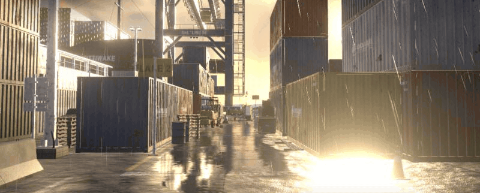
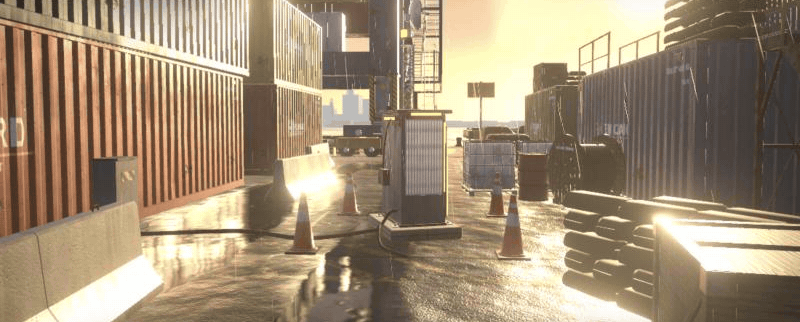
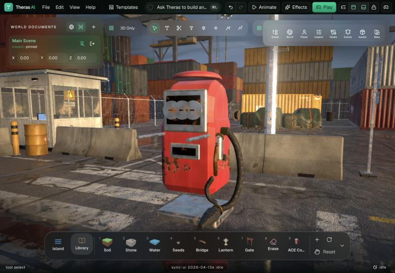
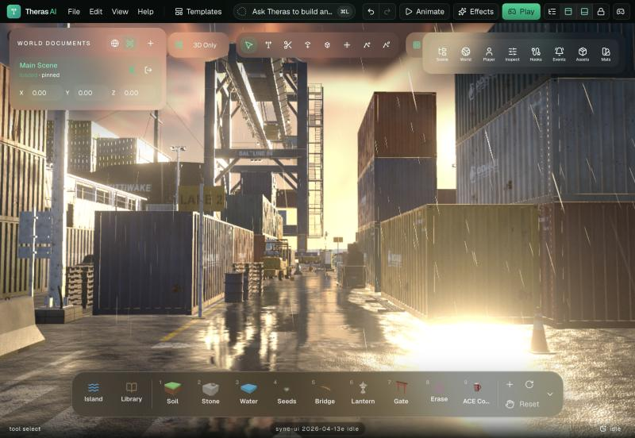
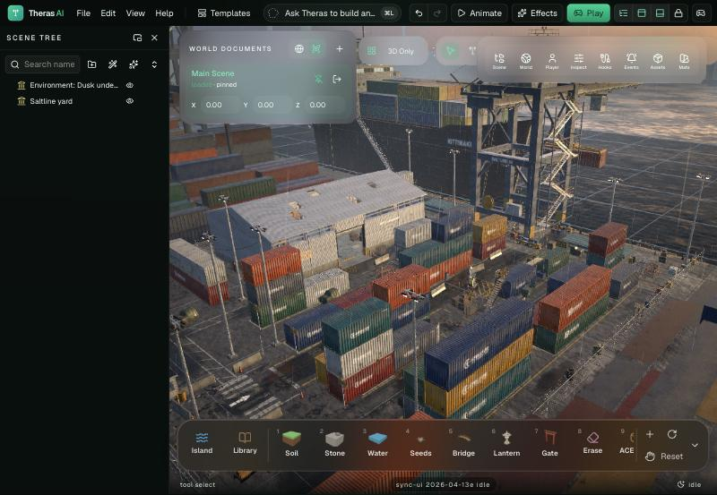
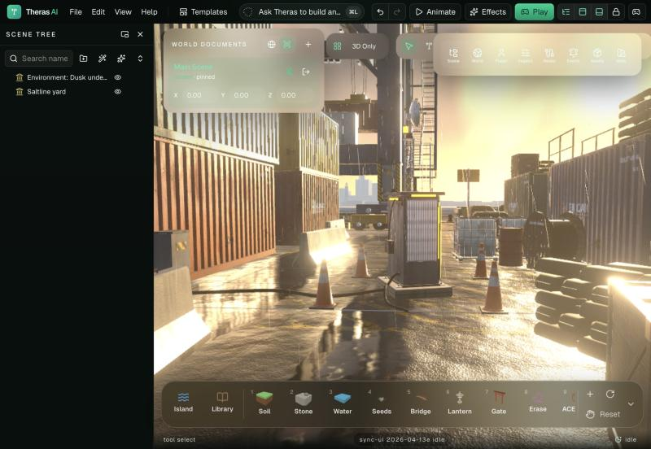
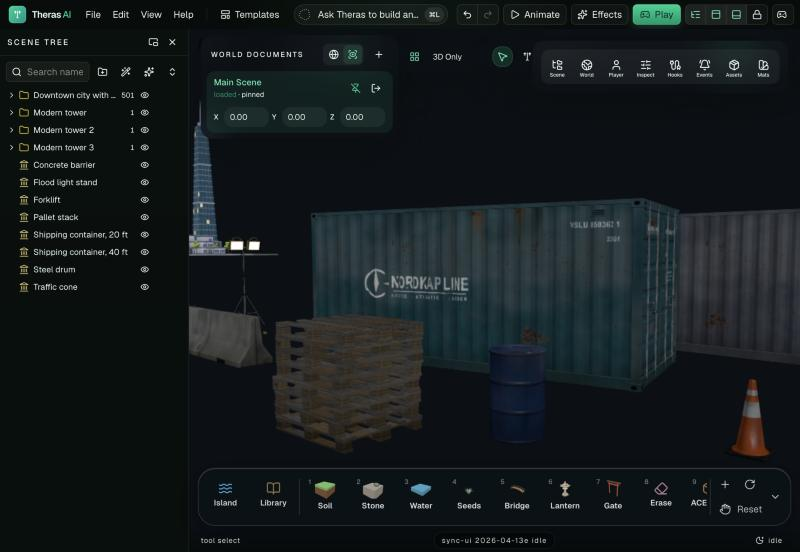
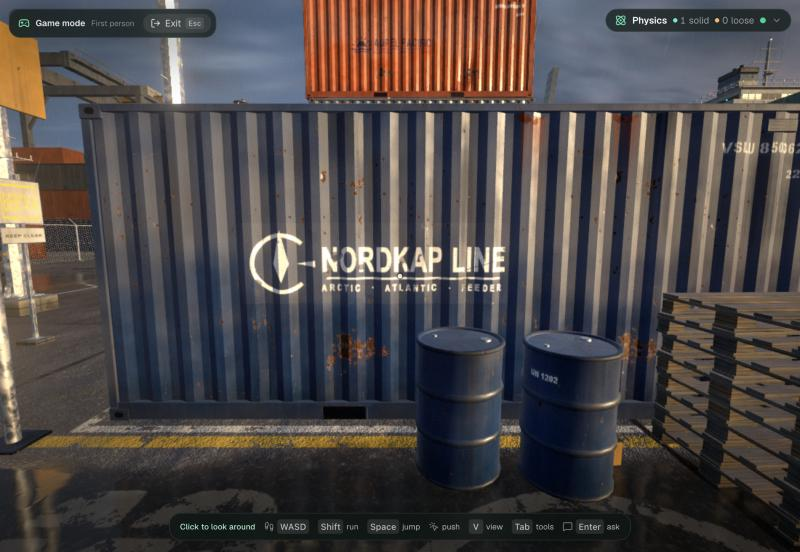
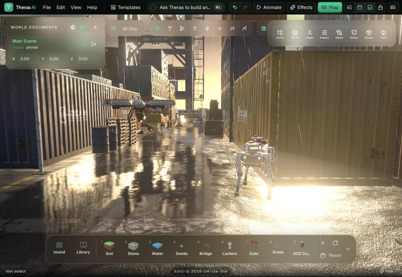
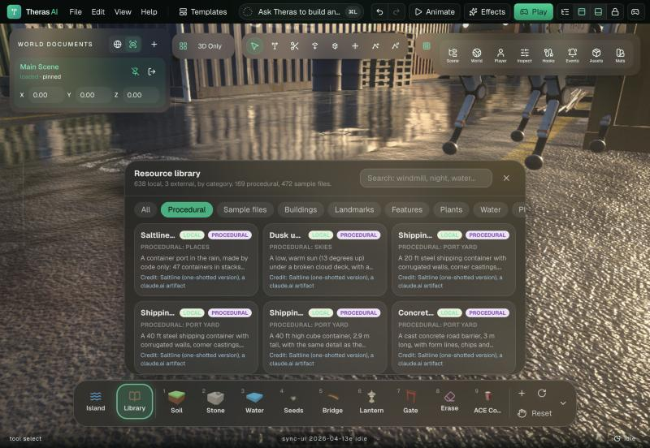

# Procedural generation in Theras AI

This document tells you how Theras AI builds an object or a place fully in code from a prompt, where that code is, and how far the result is from the quality target.

Folder: all paths start at the repository root. The editor is `apps/editor` (port 8080).

A flight through the procedural port scene in the editor. Every object, the wet ground, the rain and the sky are made by code. The motion is a time-lapse of 16 camera positions.

## What "procedural" means here

- Geometry comes from functions: boxes with chamfers, lathes, extruded profiles, tubes.
- Surfaces come from shaders. A shader draws the color, the roughness, the metalness and a height field into textures on the graphics card. The normal map comes from the height field.
- No image file, no model file and no download is used.

The library panel shows this split: "Procedural" (made by code) and "Sample files" (made from model and image files). The rule is in `apps/editor/src/lib/resources/make.ts`.

The same view as shaded surfaces and as triangles: about 950,000 triangles and 94 surfaces, all generated when the scene opens.

## From prompt to object

1. **Brief.** One model call reads the prompt and the scene and writes a brief. A thing that is in the library is placed from the library. A thing that is not there goes to the object modeler. Code: `apps/editor/src/lib/copilot/director`.
2. **Parts spec.** The modeler (a second model call) writes data, not code: 2 to 5 stages of parts. Each part is one shape with a place, a size and a palette role. Each palette role names a substance. Code: `apps/editor/src/lib/generators/parts/prompt.ts` and `spec.ts`.
3. **Check.** Code validates the spec, drops parts that float and snaps parts that do not touch. Code: `apps/editor/src/lib/generators/parts/check.ts`.
4. **Build.** Code makes one mesh for each substance and color. A box edge gets a chamfer by default (6% of the thinnest side, 4 to 30 mm). The object appears stage by stage. Code: `apps/editor/src/lib/generators/parts/build.ts`.
5. **Surfaces.** When the surface kit is ready, each mesh gets the shader-drawn surface of its substance. The mapping uses the position of the surface in space, so a part needs no texture coordinates. Code: `apps/editor/src/lib/resources/generated/parts.ts`.
6. **Change.** "Bigger", "another color" and "a ring of it around the puddle" use the same model again with no new model call. Code: `apps/editor/src/lib/copilot/director/generators/object.ts`.

A prompt result: "add a vintage red gas pump here, realistic". 29 parts and six palette roles in 31 s. The paint chips, the steel frame and the rubber hose come from the surface kit.

## Substances

24 substances are in `apps/editor/src/lib/generators/parts/surfaces.ts`: paint, plastic, metal, steel-dark, aluminium, brass, anodized, ceramic, rubber, fabric, hull, galvanized, rust, tire, wood, wood-dark, concrete, brick, cardboard, rope, carbon, hazard, diamond-plate and glass. Eleven of them take the color of the palette role. When the model gives no substance, code picks one from the name of the role.

## The surface kit

The kit is the procedural container port that Claude Fable 5.2 wrote (a public claude.ai artifact). Its code is in `apps/editor/src/vendor/port`; the adapter is `apps/editor/src/lib/resources/port`.

- 29 texture sets, 48 named surfaces, one shared shader patch.
- A surface has five layers: a base, a large variation, a middle mottle, a fine grain and a wear layer.
- Paint is a stack: steel, rust, a primer ring, paint, dirt and chalk. Damage is in clusters. Rust runs go down.
- A noise in world space changes color and roughness between two equal objects, so a repeat does not show.
- Rain makes each surface wet: darker, shinier, with beads. Surfaces are dry in a scene with no rain.
- The textures are drawn on the graphics card, so a kit belongs to one renderer.

The same kit builds the 39 procedural library entries, the template "Port yard at dusk" and its sky.

| | |
|---|---|
|  |  |
| The template "Port yard at dusk" in the editor. | The whole place: three lanes of stacks, the shed, the quay with the crane and the ship. |
|  |  |
| Wet ground: puddles mirror the scene with a picture that is drawn each frame. | Library props in a plain scene: logo, numbers, rust runs, real pallet boards. |
|  |  |
| Game mode: the yard has its own collision boxes. | The drone and the robot hound as library entries. |

The library filter "Procedural" shows the entries that are made by code.

## What is below the target today

The port scene is the target. A prompt result does not reach it yet. The differences that we know:

| Topic | The port scene | A prompt result today |
|---|---|---|
| Parts in one object | 60 to 300 | 12 to 80 |
| Shapes | profiles swept with a function, corrugation as real geometry, lathes of 20 to 30 points | ten basic shapes |
| Text and signs | stencil numbers, logos and hazard signs as worn decals | none |
| Baked shade | noise, darker down faces, a dark band at the ground, rust at rims | a gradient and ground shade |
| Dents and offsets | each repeated part is shifted a few mm and has its own brightness | none |
| Texture scale | meters for each tile | follows the size in the spec, not the final size |

The work to close these differences is planned and not done. Until then, use the library entries when the object exists there: the director does this by itself.

## How to see it

1. Open the editor on port 8080.
2. Templates, then "Port yard at dusk": the whole procedural scene.
3. Library, then the filter "Procedural": place one asset.
4. Ask Theras: "add a vintage red gas pump here, realistic": a new object, built by code.
